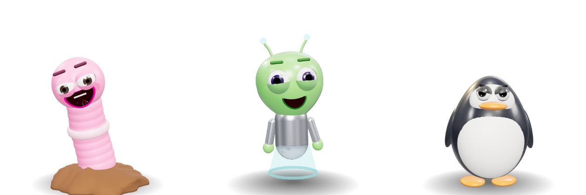
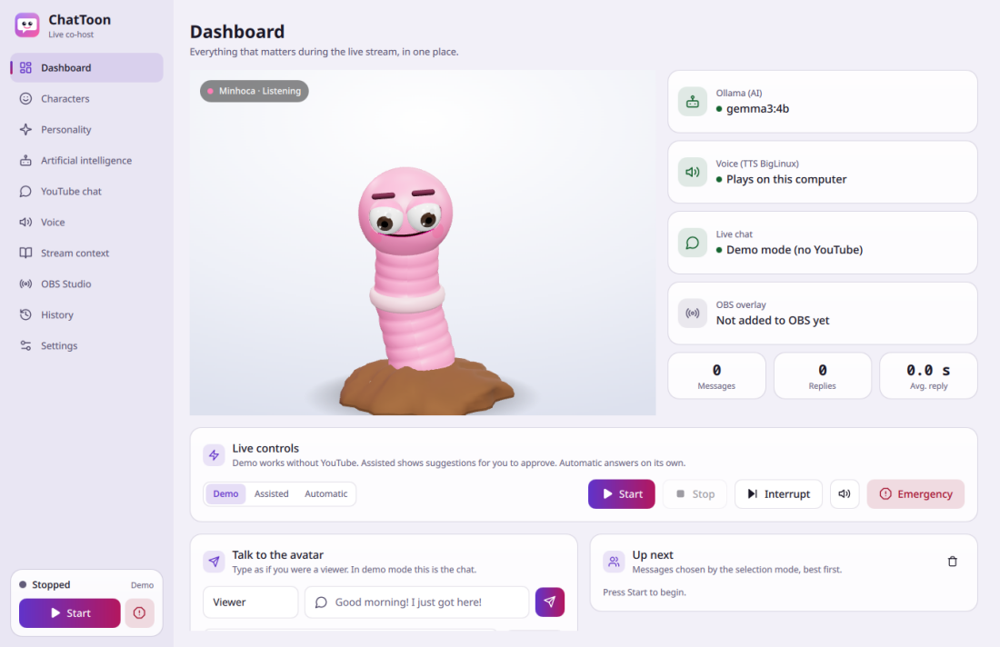
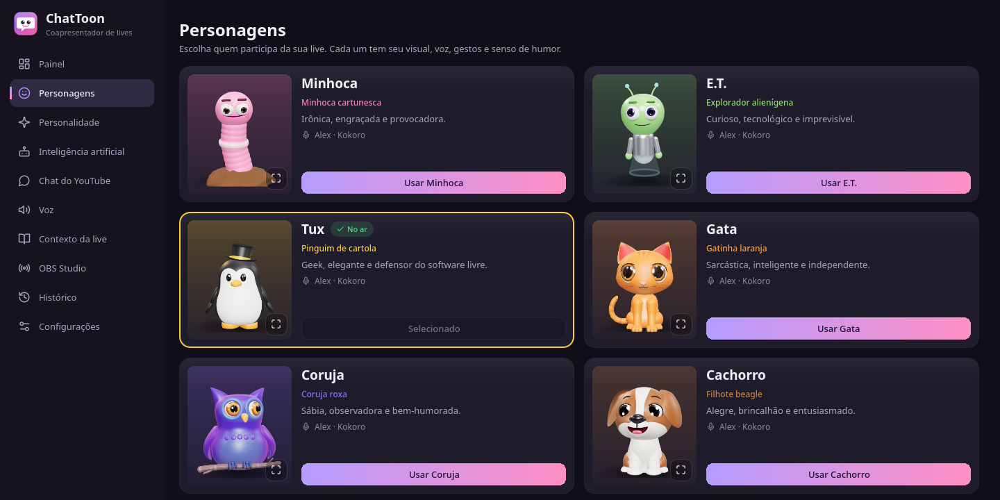
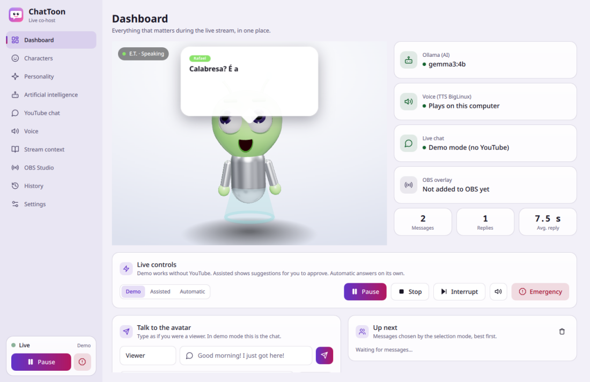
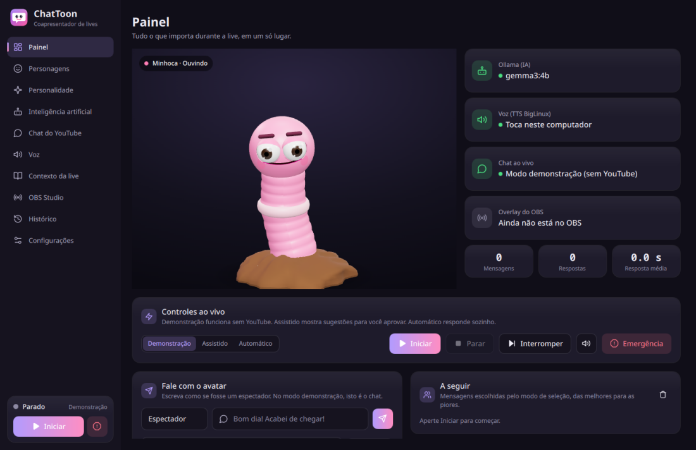
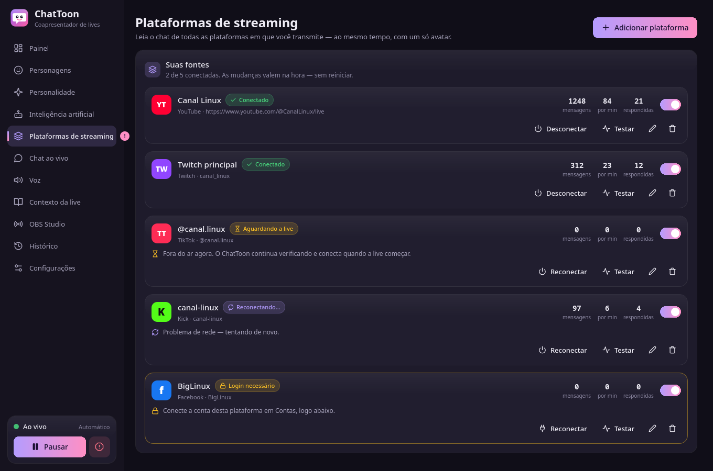
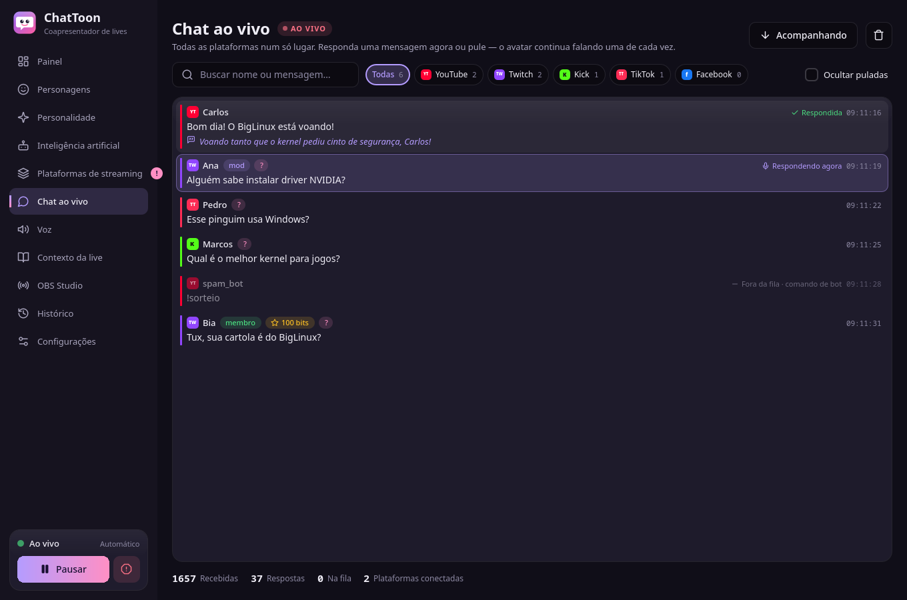

# ChatToon 2.4.1

**Um personagem 3D que participa da sua live — no YouTube, na Twitch, na Kick, no TikTok e em
outras plataformas ao mesmo tempo:** ele lê os chats — inclusive em voz alta, dizendo quem
escreveu, o quê e de onde ("Na Twitch, a Ana perguntou…") —, responde com humor próprio usando
a **IA local do BigLinux** (Ollama), fala com voz de verdade pelo **TTS BigLinux** (também com
as vozes neurais **Kokoro**) e continua vivo entre uma mensagem e outra: respira, olha em volta
e faz gestos do seu jeito — tudo num overlay com fundo transparente para o OBS Studio. Fora a
leitura dos chats, tudo roda no seu computador: sem nuvem, sem mensalidade.

> **Autor:** Pedro Bezerra — canal **InfoRecarga** ([youtube.com/@pedro_bezerra](https://www.youtube.com/@pedro_bezerra))
> **Colaborador:** Rafael Ruscher ([github.com/ruscher](https://github.com/ruscher))
> Os dois são voluntários do projeto [BigLinux](https://www.biglinux.com.br).



| Painel | Personagens |
|---|---|
|  |  |
| **Falando (o balão acompanha a voz)** | **Português, tema escuro** |
|  |  |
| **Plataformas de streaming (2.2)** | **Todos os chats num só lugar (2.2)** |
|  |  |

---

## A história

### Uma live, um chat lotado e uma ideia

Quem acompanha o **Pedro Bezerra** no canal **InfoRecarga** sabe como é: live de tecnologia e
Linux, gente chegando de todo canto, o chat correndo mais rápido do que dá para ler. Pergunta
sobre driver, alguém dizendo que o Windows travou de novo, um "boa noite" de quem acabou de
entrar, piada interna, Super Chat… e um apresentador só para dar conta de tudo isso e ainda
tocar o conteúdo da live.

Foi daí que veio a ideia do Pedro: **e se a live tivesse um coapresentador?** Não um bot que
cola respostas prontas, mas um bichinho 3D na tela, com personalidade, que lê o chat,
responde com bom humor e **fala em voz alta**, como se fosse mais um participante do programa.

### O protótipo do Pedro (a "versão 1")

O Pedro não ficou só na ideia — foi para o código. O primeiro protótipo, guardado até hoje em
[`legacy/`](legacy/), era uma colagem engenhosa de peças:

- um script Python com `pytchat` lendo o chat da live do YouTube;
- a primeira personagem era uma **cobra 3D** em Three.js, feita de "gominhos" articulados, que
  depois virou uma **lagarta** — a avó direta da nossa Minhoca;
- a resposta vinha primeiro do **Gemini, na nuvem**; depois o Pedro testou o **Ollama local**
  com um modelo mais pesado e um **Qwen** mais leve, porque IA rodando na própria máquina
  significa não depender de chave, cota nem internet boa;
- um prompt de personalidade já com as regras de ouro do canal: respostas curtas, humor
  leve, foco em tecnologia e Linux e **nada de política, religião ou tema polêmico** — "aqui a
  gente só roda código limpo, política trava o sistema!";
- a resposta era gravada num arquivo de texto, uma página HTML aberta no OBS ficava
  consultando esse arquivo, mostrava um balão de quadrinho e falava com a voz do navegador;
- e ainda um script em Node.js para experimentar o mesmo truque no chat do Rumble.

Funcionava — e funcionava o bastante para provar que a ideia era boa. Mas era um protótipo de
verdade: vários scripts para rodar na mão, a voz às vezes saía duas vezes (uma do Python, outra
do navegador), a configuração ficava espalhada pelo código e o texto do chat chegava perto
demais do terminal.

### Entra o Rafael — e nasce o "ChatToon"

O Pedro mostrou o protótipo para o amigo **Rafael Ruscher**, também voluntário do BigLinux. O
Rafael olhou aquilo e viu na hora o potencial: um bichinho de desenho animado conversando com o
chat — um *cartoon* do *chat*. Daí o nome: **ChatToon**.

E veio a pergunta seguinte: *e se isso fosse um aplicativo de verdade, que qualquer pessoa que
faz live no BigLinux pudesse instalar e usar?* O BigLinux já tinha as duas peças mais difíceis
prontas:

- a **IA local** — o Ollama, que as Configurações do BigLinux já sabem instalar;
- o **TTS BigLinux** — o leitor de texto do sistema, com vozes naturais em português (Piper,
  RHVoice, espeak-ng) e todo o tratamento de números, abreviações e horários que um texto
  precisa para soar bem em voz alta.

Faltava juntar tudo num programa só, bonito, seguro e fácil de usar.

### Da ideia ao aplicativo (a versão 2.0.0)

A partir do protótipo do Pedro, o ChatToon foi reconstruído do zero, mantendo o espírito
original e resolvendo um por um os problemas encontrados (a auditoria está em
[docs/01-audit.md](docs/01-audit.md)):

- **um aplicativo de desktop** em PySide6/QML, com assistente de primeira execução, tema claro
  e escuro e interface traduzida para português;
- **três personagens 3D originais**, modelados por código: a **Minhoca** (herdeira da lagarta
  do Pedro), o **E.T.** e o **Tux**, com expressões, piscadas, olhar, gestos e boca que se
  mexe de acordo com o áudio real;
- **personalidade configurável**, com memória curta, consciência do horário, contexto do
  canal e as mesmas regras de conteúdo que o Pedro escreveu no primeiro prompt;
- **uma única voz por resposta**, sempre — o problema da voz duplicada deixou de existir por
  projeto;
- **segurança de verdade**: nada que vem do chat é executado, o overlay só escuta no próprio
  computador, e quem está no chat não consegue "reprogramar" o personagem.

O protótipo foi a versão 1. O aplicativo nasceu como **versão 2.0.0** — e o InfoRecarga é,
com orgulho, o canal onde tudo começou.

### O elenco cresce (a versão 2.1.0)

Com o aplicativo no ar, vieram os pedidos de quem usa: "e se ele lesse a mensagem antes de
responder, pra live inteira saber do que se trata?", "a voz Kokoro do TTS BigLinux é tão
natural, por que não funciona no ChatToon?", "o pinguim precisa de mais charme" e "quero mais
bichinhos!". A versão 2.1.0 responde a tudo isso:

- **leitura das mensagens**: "Carlos perguntou: qual distribuição Linux vocês recomendam?" —
  exatamente como foi escrito, sem a IA mexer —, e só depois a resposta com a personalidade do
  personagem;
- **vozes Kokoro funcionando de verdade**, sem áudio duplicado e falando frase por frase para
  começar rápido;
- um **Tux novo, de cartola**, redondinho como um brinquedo de vinil, que tira o chapéu para
  cumprimentar a live;
- três personagens novos: a **Gata** sarcástica, a **Coruja** sabichona do kernel e o
  **Cachorro** que abana o rabo para qualquer atualização do pacman;
- e um **sistema de animação** que deixa todos vivos mesmo quando ninguém está falando.

### Uma live, várias plataformas (a versão 2.2.0)

Muita gente transmite a mesma live no YouTube, na Twitch, na Kick e no TikTok ao mesmo tempo —
e o personagem só enxergava o YouTube. A 2.2.0 transforma o ChatToon num co-apresentador
**multiplataforma**:

- uma página **Plataformas de streaming** onde você cola o link da live ou do canal — a
  plataforma é reconhecida sozinha —, testa a conexão e liga ou desliga cada fonte **durante
  a live**, sem reiniciar;
- uma página **Chat ao vivo** com as mensagens de todas as plataformas numa lista só, com busca,
  filtros, contadores e o botão "Responder agora";
- uma **fila justa**: o chat mais movimentado não leva todas as respostas (modos Equilibrado,
  Prioridade personalizada e Inteligente com divisão entre plataformas);
- o personagem **diz de onde veio a mensagem** e o balão do OBS ganha uma etiqueta discreta
  "Twitch • Ana" — e continua sendo **uma voz de cada vez**;
- logins oficiais só onde a plataforma exige, guardados no **chaveiro do sistema**, nunca em
  perfis exportados.

Cada plataforma está classificada com honestidade — funcional, limitada, experimental ou
indisponível — de acordo com o que ela realmente permite (veja a tabela abaixo).

### Software livre, feito por voluntários

O ChatToon é software livre (GPL-3.0-or-later) e nasceu dentro da comunidade **BigLinux**, feito
por voluntários no tempo livre. Se você faz live, use, teste, abra *issues*, mande sugestões e
melhorias. É assim que o projeto cresce.

---

## Recursos

- **Seis personagens 3D procedurais** (Three.js, sem downloads nem modelos de terceiros):
  **Minhoca**, irônica e provocadora, saindo da terra; **E.T.**, curioso e imprevisível, que
  levita com antenas de mola; **Tux**, o pinguim geek e elegante **de cartola**; **Gata**,
  sarcástica e independente, com cauda articulada; **Coruja**, sábia e observadora, pousada num
  galho; **Cachorro**, alegre e brincalhão, de orelhas caídas. Expressões (feliz, rindo,
  surpreso, confuso, irritado, comemorando, pensando), piscadas, olhar, gestos próprios de cada
  espécie e **sincronia labial pelo envelope de volume do áudio real** — a boca só se mexe
  quando existe áudio de verdade.
- **Vivos o tempo todo**: um motor de animação com estados (aguardando, prestando atenção,
  lendo, pensando, falando, reagindo, comemorando, pausado, emergência), respiração, olhar
  coordenado com a cabeça, mudanças de postura e gestos aleatórios sem repetição. Dá para
  ajustar intensidade e frequência, desligar ou **reduzir o movimento** para quem é sensível.
- **Leitura das mensagens** antes da resposta: desativada, só o nome ou nome + mensagem,
  com limite de caracteres, pausa e voz própria opcional. Links e emojis são ignorados, nomes
  estranhos ficam pronunciáveis e mensagens bloqueadas nunca são lidas. O balão mostra a
  mensagem do espectador e troca suavemente para a resposta.
- **Motor de personalidade com IA local**: predefinições (Amigável, Comediante, Zoeiro,
  Geek, Caos controlado, Personalizado), nove ajustes de humor, contexto do canal, noção do
  horário real, bordões e chamadas para ação ocasionais. As mensagens dos espectadores são
  tratadas como dados, **nunca como instruções**.
- **Primeiro a resposta certa, depois a piada**: cada mensagem é classificada localmente
  (conta, fato, explicação, cumprimento, boa notícia, piada, provocação, ordem ao sistema…).
  Contas são **calculadas com exatidão** pelo ChatToon (sem `eval`), perguntas objetivas usam
  pouca aleatoriedade, perguntas de Linux e computação recebem uma **folha de referência
  conferida**, e cada resposta é verificada antes de ser falada. Nas perguntas verificáveis do conjunto de
  teste, os acertos subiram de 29 % para 90 % com o `qwen3.5:2b` e de 46 % para 97 % com o
  `llama3.1:8b`, com a mesma latência (ver [docs/28](docs/28-validation-results.md)).
- **Memória da conversa**: o personagem lembra o que cada espectador contou ("você estava
  fazendo um app em Python e QML, já terminou a interface?"), separado por plataforma e conta.
  Só vira memória o que foi realmente falado; mensagens apagadas por moderadores são esquecidas.
  Lembrar entre lives é opcional, local e com prazo de retenção. Gerencie em *Chat ao vivo ›
  Memória*.
- **Emoções que acompanham a conversa**: surpresa e depois comemoração para boas notícias,
  nada de risada para quem está triste, humores próprios de cada espécie quando ninguém fala
  (respeitando *reduzir movimento*).
- **Falas espontâneas** (opcionais): quando o chat fica quieto, o personagem convida o público,
  conta curiosidades conferidas da sua espécie ou do Linux e comenta o assunto da live — sempre
  depois dos espectadores, com intervalo e horário silencioso configuráveis.
- **Contexto da live com IA**: lê o que as suas plataformas publicam (título, canal, categoria)
  e sugere descrição, bordões, assuntos e chamadas para ação, com prévia editável — nada muda
  sem a sua aprovação.
- **Várias plataformas ao mesmo tempo** (multistream): YouTube, Twitch, Kick, TikTok, Facebook,
  Instagram e X, inclusive **vários canais da mesma plataforma**. Cada fonte tem a sua própria
  conexão, estado, reconexão com espera progressiva e aleatória, e tratamento de erros — **a
  queda de uma nunca derruba as outras**. IDs e espectadores são separados por plataforma e
  fonte: a "ana" da Twitch e a "ana" do YouTube são pessoas diferentes.
- **Chat ao vivo unificado**: lista virtualizada (fluida com milhares de mensagens), busca,
  filtro por plataforma, mensagens puladas e o motivo, resposta gerada embaixo de cada mensagem,
  "Responder agora" e "Pular", e mensagens apagadas por moderadores somem da fila.
- **Seleção de mensagens**: inteligente (com divisão justa entre plataformas), equilibrada,
  prioridade personalizada por fonte, ordem de chegada, menções, perguntas, moderadores, membros,
  aleatória ou manual; intervalo por espectador, validade da mensagem, limite de fila que
  descarta primeiro do chat mais cheio, espectadores favoritos, palavras bloqueadas e prioridade
  para mensagens pagas (Super Chat, Bits, Kicks, presentes — nunca comparados por valor).
- **Três modos**: Demonstração (sem plataforma), Assistido (você aprova cada resposta) e
  Automático.
- **Uma voz de cada vez, sempre**: vozes do TTS BigLinux (Piper, RHVoice, espeak-ng e
  **Kokoro**) geradas uma única vez e tocadas pelo aplicativo **ou** pela fonte do OBS — nunca
  pelos dois, e a leitura nunca se sobrepõe à resposta.
- **Overlay para o OBS** num endereço local secreto: fundo transparente ou chroma key, balão de
  fala com a etiqueta da plataforma (opcional), controles de tamanho, posição, câmera, luz,
  qualidade e FPS, com prévia ao vivo dentro do aplicativo.
- **Controles ao vivo**: iniciar, pausar, parar, interromper, silenciar, limpar fila, mandar o
  personagem dizer uma frase, disparar reações e um **botão de emergência** que cala tudo de uma
  vez.
- Tema claro/escuro/sistema, atalhos de teclado, assistente de primeira execução, interface em
  inglês com tradução completa para português do Brasil, perfis de transmissão (exportados sem
  segredos).

## Instalação (BigLinux / Manjaro / Arch)

```bash
git clone https://github.com/ruscher/ChatToon.git
cd ChatToon/packaging/arch
makepkg -si
```

Depois abra **ChatToon** pelo menu (ou rode `chattoon`). Para conferir a versão:
`chattoon --version` → `chattoon 2.4.1`. Para remover: `sudo pacman -R chattoon`.

| Tipo | Pacotes |
|---|---|
| Obrigatórios | `python`, `pyside6`, `python-aiohttp`, `qt6-svg`, `qt6-webengine`, `iproute2` |
| Para compilar | `python-build`, `python-installer`, `python-setuptools`, `python-wheel`, `qt6-tools` |
| Opcionais | `tts-biglinux` (voz, repositório do BigLinux), `ollama` (IA — ou um Ollama em outra máquina da rede), `pipewire-audio` / `pulseaudio-utils` / `alsa-utils` (áudio no desktop), `obs-studio`, `python-gobject` + `libsecret` (logins no chaveiro do sistema), `python-cryptography` (webhooks oficiais da Kick), `polkit` (instalar Ollama e vozes e liberar a rede de casa pelo app), `caddy` (overlay pela internet com HTTPS) |
| Extra (TikTok) | `chattoon extras install tiktok` — instala a biblioteca TikTokLive numa pasta privada (`~/.local/share/chattoon/extras`), sem mexer no sistema |

O PKGBUILD compila a partir deste repositório (nada é baixado durante o build): gera a tradução
com `lrelease`, monta o *wheel* com `python -m build`, instala com `python -m installer` e
coloca o atalho `.desktop`, o ícone, este README e a licença do Three.js nos lugares certos.

Para rodar direto do código-fonte, sem instalar:

```bash
sudo pacman -S --needed pyside6 python-aiohttp qt6-svg qt6-webengine
python -m chattoon            # aplicativo
python -m chattoon doctor     # verifica Ollama, TTS BigLinux, áudio e plataformas
python -m chattoon ask "Meu Windows travou!" --character tux
```

### IA local (Ollama)

O ChatToon usa o Ollama já instalado na máquina (as Configurações do BigLinux sabem instalar)
e **nunca altera a configuração dele**. Escolha qualquer modelo de conversa instalado na página
**Inteligência artificial**, ou baixe um dos sugeridos ali mesmo, com barra de progresso.
`gemma3:4b` (3,3 GB) é a sugestão padrão: bom português do Brasil, cerca de 20 tokens/s numa
GTX 1050 Ti. Detalhes de latência em [docs/04-ollama.md](docs/04-ollama.md).

### Voz (TTS BigLinux)

Instale o `tts-biglinux` (e, para as vozes neurais, o `biglinux-kokoro-tts`). O ChatToon
importa o catálogo de vozes, a normalização de texto, o sintetizador nativo e o construtor de
comandos do Kokoro dele, então **toda voz que funciona no TTS BigLinux funciona no ChatToon**
— incluindo as brasileiras `pf_dora`, `pm_alex` e `pm_santa`. Cada personagem pode ter sua
própria voz, velocidade e tom (página **Voz**, com botão de prévia); a leitura das mensagens
pode usar outra voz. Detalhes em [docs/06-tts.md](docs/06-tts.md).

### Plataformas de streaming

| Plataforma | Situação | Como o ChatToon lê | O que você precisa |
|---|---|---|---|
| **YouTube** | ✅ funcional | chat público da live (como a janela pop-out) | só o link da live — ou o `@canal`, que acompanha toda live nova |
| **Twitch** | ✅ funcional | **EventSub** oficial com a sua conta, ou modo visitante (IRC só leitura, sem login) | nada para o modo visitante; para o oficial, um app gratuito "Public" em dev.twitch.tv e **Conectar conta** (código na tela, sem senha) |
| **Kick** | 🧪 experimental | conexão pública de chat usada pelo próprio kick.com (não oficial) · ou **webhooks oficiais** | nada; para o oficial, o seu app da Kick (Client ID + secret) **e** um endereço HTTPS público que você encaminha para `127.0.0.1` |
| **TikTok** | 🧪 experimental | biblioteca não oficial TikTokLive + serviço de assinatura Euler Stream (terceiro) | `chattoon extras install tiktok`; a live precisa estar no ar |
| **Facebook** | ⚠️ limitada | Graph API oficial (comentários da live) | **Página** (perfil pessoal não) + token do seu próprio app da Meta |
| **Instagram** | ⚠️ limitada | Graph API oficial (`live_media`) | conta **profissional** ligada a uma Página + token do seu app da Meta |
| **X** | ⚠️ limitada / ⛔ | não existe API para o chat de vídeos ao vivo nem de Spaces; dá para ler **respostas ao post** que anuncia a live | o seu Bearer token da API do X (paga por post lido) |

Para adicionar: **Plataformas de streaming → Adicionar plataforma**, cole o link
(`twitch.tv/canal`, `kick.com/canal`, `tiktok.com/@canal/live`, `youtube.com/@canal`…), clique
em **Testar conexão** e em **Adicionar**. Quem já usava a 2.1 não precisa fazer nada: o link do
YouTube salvo vira a primeira fonte automaticamente.

Tokens e segredos são colados em **Plataformas de streaming → Contas** e ficam no **chaveiro do
sistema** (KWallet, Chaveiro do GNOME). O ChatToon **nunca pede senha**, nunca abre portas para a
internet e nunca coloca credenciais em logs, no overlay ou em perfis exportados. Detalhes e
fontes da pesquisa em [docs/14-platform-api-research.md](docs/14-platform-api-research.md).

## Como usar

1. **Primeira execução**: o assistente verifica o Ollama e a voz e deixa você escolher um
   dos seis personagens.
2. Página **Personagens**: veja cada um de perto, teste expressões, gestos e voz na prévia ao
   vivo (é exatamente o que o OBS mostra) e ajuste as **animações em repouso**.
3. Página **Voz**: escolha a voz de cada personagem (Piper, RHVoice, espeak-ng ou Kokoro) e, em
   **Leitura das mensagens**, se ele lê só o nome, nome + mensagem ou responde direto.
4. **Experimente** no modo **Demonstração**: digite no Painel como se fosse alguém do chat.
5. Página **Plataformas de streaming**: adicione cada plataforma onde a live passa (link ou
   canal), teste a conexão e escolha como a atenção é dividida entre elas. Durante a live, a
   página **Chat ao vivo** mostra tudo junto.
6. Página **Contexto da live**: canal, assunto, convidados, temas proibidos e chamadas
   para ação.
7. Página **OBS Studio**: copie o endereço do overlay → no OBS, adicione uma fonte
   **Navegador** com esse endereço, em 1920×1080. Se a voz deve sair pelo OBS, escolha
   *Dentro do OBS* na página Voz e ative *Control audio via OBS* nas propriedades da fonte no OBS.
   O OBS está em outro computador? Siga o tutorial [Seu próprio domínio para o overlay](docs/21-dominio-proprio.md)
   (domínio grátis no DigitalPlat, DNS na Cloudflare, roteador e Caddy).
8. Mude para **Assistido** ou **Automático** e aperte **Iniciar** (`Ctrl+Espaço`).

Atalhos: `Ctrl+Espaço` iniciar/pausar · `Ctrl+.` interromper · `Ctrl+M` silenciar ·
`Ctrl+Shift+X` ou `Pause` parada de emergência · `Ctrl+1…9` páginas. Na voz, a opção **Dizer
de qual plataforma veio a mensagem** fica em *Leitura das mensagens* (padrão: só quando duas
ou mais plataformas estão ao vivo).

## Detalhes técnicos

### Arquitetura

```
┌──────────────────────── processo do desktop ─────────────────────┐
│  thread principal do Qt             thread asyncio (core/runtime) │
│  ┌──────────────┐  slots/props   ┌─────────────────────────────┐ │
│  │ páginas QML  │◄──────────────►│ gui/backend.py (ponte)      │ │
│  │ (gui/qml)    │  sinais Qt em  │   ▲ EventBus (core/events)  │ │
│  └──────────────┘     fila       │   │                         │ │
│        │ prévia QtWebEngine      │ ChatToonEngine (core/engine)│ │
│        ▼                         │  ├ Conectores (multistream) │ │
│  página do overlay (prévia)      │  ├ MessageSelector          │ │
│                                  │  ├ Brain (personalidade)    │ │
│                                  │  ├ OllamaClient ──► Ollama  │ │
│                                  │  ├ BigLinuxTTS ──► módulos do tts-biglinux
│                                  │  ├ AudioPlayer (pw-play…)   │ │
│                                  │  └ OverlayServer (aiohttp)  │ │
│                                  └──────────┬──────────────────┘ │
└─────────────────────────────────────────────┼────────────────────┘
              127.0.0.1:<porta>/o/<token>/ (HTTP + WebSocket, só eventos)
                                              ▼
                                Fonte Navegador do OBS
```

| Componente | Módulo |
|---|---|
| Controlador (máquina de estados `stopped/running/paused/emergency`, fases `idle/thinking/speaking`) | `chattoon/core/engine.py` |
| Configurações (dataclasses, leitura tolerante, gravação atômica com permissão 0600, perfis) | `chattoon/core/config.py` |
| Leitor do chat do YouTube | `chattoon/core/youtube_chat.py` |
| Multistream: contrato dos conectores, gerenciador, links, conectores | `chattoon/core/streams/` |
| Logins no chaveiro do sistema e máscara de segredos nos logs | `chattoon/core/credentials.py` |
| Chat unificado (modelo Qt virtualizado) | `chattoon/gui/feed.py` |
| Fila e seleção de mensagens | `chattoon/core/messages.py` |
| Personalidade e personagens | `chattoon/core/brain.py`, `chattoon/core/characters.py` |
| Cliente do Ollama (streaming, *schema* JSON, *timeout*, cancelamento) | `chattoon/core/ollama.py` |
| Voz (TTS BigLinux, reprodução) | `chattoon/core/tts.py` |
| Servidor do overlay (aiohttp + WebSocket) | `chattoon/core/overlay_server.py` |
| Barramento de eventos | `chattoon/core/events.py` |
| Laço asyncio em thread própria | `chattoon/core/runtime.py` |
| Interface (PySide6 + QML) | `chattoon/gui/` |
| Animação dos personagens | `chattoon/web/overlay/rig.js`, `chattoon/web/overlay/characters/*.js` |
| Linha de comando (`gui`, `doctor`, `ask`, `extras`, `--version`) | `chattoon/cli.py` |

### O caminho de uma mensagem

```
mensagem de qualquer plataforma (YouTube, Twitch, Kick, TikTok…)
 → normalização (plataforma, fonte, id e espectador separados por fonte)
 → validação (limpeza, caracteres de controle/bidi, tamanho)
 → filtro (vazia, !comandos, palavras bloqueadas, duplicadas, repetidas, modo menções)
 → seleção (modo, pontuação, divisão justa entre plataformas, intervalo por espectador, validade)
 → contexto (prompt do sistema + memória + contexto da live)
 → Ollama (schema JSON, streaming, timeout, cancelamento)
 → validação da resposta (JSON, remove Markdown/emoji/URL, limite de frases e caracteres,
   checagem de temas proibidos, frase segura de reserva)
 → chamada para ação opcional
 → TTS (um único WAV + envelope de volume)
 → evento "falar" no overlay + reprodução em um único destino
 → histórico
```

Só uma resposta é processada por vez, então as falas nunca se atropelam e as gerações nunca
disputam a GPU. Trabalho bloqueante (síntese de voz, espera do player de áudio) vai para
`asyncio.to_thread`; a interface conversa com o motor por `run_coroutine_threadsafe` e recebe os
eventos por sinais Qt em fila, por isso **nunca trava** esperando a rede, o modelo ou a voz.

### Voz e sincronia labial

1. Lista as vozes de todos os motores prontos do TTS BigLinux; cada personagem recebe a voz
   escolhida ou a mais adequada (ex.: Minhoca → Letícia/RHVoice), com a voz padrão do TTS
   BigLinux como reserva.
2. Normaliza o texto com o `process_text` do TTS BigLinux (emoji removido antes, URLs não são
   lidas).
3. Gera **um WAV**: Piper e espeak-ng pelo módulo nativo `tts_engine`, RHVoice pelo
   `RHVoice-test`, Kokoro pelo `koko text` montado pelo próprio TTS BigLinux (o modo `pipe`,
   que toca o som sozinho, nunca é usado); tudo vira PCM 16 bits mono. Nenhum texto passa por
   um shell, e interromper mata o processo do motor na hora.
   Com Kokoro, a fala é gerada **frase por frase**: uma toca enquanto a próxima é gerada.
4. Calcula o envelope de volume (RMS, 50 por segundo, normalizado no percentil 95) que move a
   boca do personagem.
5. Toca **uma vez**: pelo `pw-play`/`paplay`/`aplay` no desktop **ou** dentro da fonte do OBS.

| Voz | Duração do áudio | Tempo de síntese |
|---|---|---|
| Letícia (RHVoice) | 3,1 s | 0,49 s |
| Faber (Piper, medium) | 1,9 s | 1,6 s a frio, 0,07 s aquecido |
| espeak-ng pt-br | 2,4 s | 0,01 s |
| Dora (Kokoro, pf_dora) | 2,95 s | 2,9 s |
| Alex (Kokoro, pm_alex) | 8,95 s | 8,3 s |

**Leitura antes da resposta**: quando uma mensagem é escolhida, o personagem presta atenção,
lê "Fulano disse/perguntou: …" (o texto do espectador, só normalizado para a voz) e, enquanto
lê, a IA já está gerando — e a voz já está preparando — a resposta. A ordem é garantida:
leitura → pausa configurável → resposta, nunca as duas ao mesmo tempo.

### Segurança e privacidade

- **Nada do chat é executado**: não há shell em lugar nenhum; o texto chega à voz por *stdin*.
- **Ninguém do chat reprograma o personagem**: as mensagens vão num bloco de dados delimitado e
  escapado, as regras proíbem seguir instruções embutidas e a resposta é validada.
- **A saída da IA nunca é executada**: é só texto e uma emoção de uma lista fixa.
- **Overlay protegido**: escuta só em `127.0.0.1`, exige um token secreto no endereço, recusa
  `Host` que não seja local (contra *DNS rebinding*), usa CSP `default-src 'self'` e ignora
  qualquer comando vindo pelo WebSocket. Para abrir de outro computador, um proxy reverso HTTPS
  (Caddy, nginx…) na mesma máquina encaminha para `127.0.0.1`, e o domínio dele é o único
  aceito além dos locais — só `https://`.
- **Limites**: 300 caracteres por mensagem, quadros WebSocket de 4 KB, requisições de 64 KB e
  *timeouts* em tudo que é rede.
- **Permissões mínimas**: roda como usuário comum, nunca pede root; configurações com permissão
  0600, áudios temporários em pasta 0700.
- **Logins sem senha**: entrada oficial (código de dispositivo da Twitch) ou tokens que você
  cola, com só as permissões de leitura necessárias, guardados no **chaveiro do sistema** (Secret
  Service/libsecret; sem chaveiro, num arquivo 0600). "Desconectar" revoga e apaga a cópia local.
- **Segredos nunca vazam**: um filtro mascara tokens em todos os logs; perfis exportados, URLs do
  overlay e eventos do OBS nunca levam credenciais; opções de fonte que pareçam segredo são
  descartadas.
- **Links colados não viram requisições arbitrárias**: o reconhecimento é só análise de texto, e
  cada conector fala apenas com os servidores fixos da sua plataforma (sem SSRF). O webhook
  oficial da Kick escuta só em `127.0.0.1` e confere a assinatura RSA, o horário e duplicatas.
- **Sem telemetria**: as únicas conexões externas são os chats das plataformas configuradas
  (no TikTok, também o serviço de assinatura Euler Stream) e o Ollama configurado.

Mais em [docs/09-security.md](docs/09-security.md).

### Onde ficam os dados

| Caminho | Conteúdo |
|---|---|
| `~/.config/chattoon/settings.json` | configurações (permissão 0600) |
| `~/.config/chattoon/profiles/*.json` | perfis de transmissão salvos (sem segredos) |
| chaveiro do sistema (`org.biglinux.ChatToon`) | logins e tokens das plataformas |
| `~/.local/share/chattoon/credentials.json` | só se não houver chaveiro: logins (permissão 0600) |
| `~/.local/share/chattoon/extras/` | componentes opcionais (TikTokLive), só se você instalar |
| `~/.local/share/chattoon/memory.sqlite3` | memórias entre lives (0600), só se *Lembrar entre lives* estiver ligado |
| `$TMPDIR/chattoon-tts-*/` | últimas 20 respostas geradas (0700), apagadas ao sair |

### Desempenho medido

- Latência por resposta com `gemma3:4b` numa GTX 1050 Ti: ~8–9 s, estável ao longo da live.
  Síntese de voz: 0,1–0,5 s.
- Memória do motor após 800 mensagens pelo caminho completo: **+3 KB** nas últimas 400.
- Overlay após 400 falas e 57 trocas de personagem: geometrias e texturas de volta ao ponto de
  partida.

### Testes

```bash
sudo pacman -S --needed python-pytest
python -m pytest
```

São mais de 290 casos de teste cobrindo multistream (quatro plataformas ao mesmo tempo, falhas
isoladas, reconexão, justiça da fila, migração), cada conector contra servidores falsos locais
(Twitch IRC/EventSub/OAuth, Kick Pusher/webhook com assinatura RSA, TikTok, Facebook, Instagram,
X), chaveiro e ausência de segredos em logs, perfis e overlay, motor, seleção de mensagens,
configurações, Ollama, personalidade, TTS
(incluindo o Kokoro com um `koko` simulado: modo sem reprodução, conversão do WAV, erros,
cancelamento e *timeout*), leitura das mensagens (ordem, interrupção, pausa, filtros, modos
Demonstração/Assistido/Automático), overlay, chat do YouTube, tradução, interface e
empacotamento (incluindo a checagem de que o `pkgver` do PKGBUILD é igual à versão do projeto).

Com Chrome ou Chromium instalado, `tests/test_overlay_render.py` abre o overlay de verdade num
navegador sem janela e confere os seis personagens: carregamento, gestos, orçamento de
desempenho, fundo transparente durante a animação, balão de leitura → resposta sem cobrir o
rosto, memória de GPU estável nas trocas e boca parada quando não há áudio real.
`python -m pytest --run-live` testa também Ollama e TTS BigLinux reais (vozes `pf_dora` e
`pm_alex`, se instaladas).

## Solução de problemas

| Problema | O que fazer |
|---|---|
| Ollama "Parado" | `sudo systemctl start ollama` (ou instale nas Configurações do BigLinux) e clique em *Verificar de novo* |
| Nenhum modelo | Baixe um modelo sugerido na página de IA |
| Voz "Indisponível" | `sudo pacman -S tts-biglinux` |
| Chat "indisponível"/"desativado" | A live não está no ar, o chat está desligado ou é só para membros; a mensagem diz qual |
| OBS não mostra nada | O aplicativo precisa estar aberto; confira o endereço; deixe *Shutdown source when not visible* desmarcado na fonte do OBS |
| "forbidden" pelo domínio | Preencha *OBS Studio → Acesso de outro computador* com o endereço `https://` exato do proxy (domínio e porta). Outros erros: [tutorial do domínio](docs/21-dominio-proprio.md#solução-de-problemas) |
| Voz fora do OBS com *Dentro do OBS* | Ative *Control audio via OBS* nas propriedades da fonte Navegador; sem isso o OBS toca a voz direto nos alto-falantes |
| Voz duas vezes | Não acontece por projeto; se ouvir eco, o OBS está capturando o *Áudio do desktop* **e** a fonte |
| Respostas lentas | Diminua a *Memória da conversa*, use um modelo menor, deixe só um modelo carregado |
| Fonte em "Aguardando a live" | O canal não está ao vivo; o ChatToon conecta sozinho quando a live começar |
| Fonte em "Login necessário" | Conecte a conta (Twitch) ou cole o token (Meta, X) em *Plataformas de streaming → Contas* |
| Kick "bloqueado" | Abra `kick.com/api/v2/channels/<canal>` no navegador, copie `chatroom.id` e cole em *Número da sala de chat* na fonte |
| TikTok "não instalado" | `chattoon extras install tiktok` e reinicie o ChatToon |
| Diagnóstico das plataformas | `chattoon doctor` ou *Configurações → Diagnóstico* |

## Limitações conhecidas e próximos passos

- A fala começa depois que a resposta inteira é gerada pela IA (as vozes Kokoro já falam frase
  por frase, mas o texto ainda não vem em *streaming* do Ollama).
- O Kokoro gera o áudio mais ou menos no tempo em que ele dura; em computadores modestos,
  prefira Piper para respostas longas.
- Comemorações de novos inscritos/membros dependem de eventos que o chat público não informa.
- A fonte do OBS é adicionada à mão (com passo a passo no aplicativo); sem obs-websocket ainda.
- A boca acompanha o volume, não os fonemas.
- **Kick** (modo padrão) e **TikTok** usam métodos não oficiais e podem parar sem aviso; o
  TikTok depende de um serviço de terceiros (Euler Stream, ~2.500 conexões/dia grátis).
- **Facebook/Instagram** exigem um app próprio na Meta e só leem Páginas e contas profissionais;
  **X** não tem API para o chat de lives nem de Spaces (só respostas a um post, pela API paga).
- O conector do Rumble (ideia do protótipo) ainda não existe; a arquitetura de conectores já
  permite adicioná-lo.

Lista completa em [docs/11-release.md](docs/11-release.md).

## Documentação

[Auditoria](docs/01-audit.md) · [Arquitetura](docs/02-architecture.md) · [UI/UX](docs/03-ui-ux.md) ·
[Ollama](docs/04-ollama.md) · [YouTube](docs/05-youtube.md) · [TTS](docs/06-tts.md) ·
[Avatares](docs/07-avatars.md) · [OBS](docs/08-obs.md) · [Segurança](docs/09-security.md) ·
[Testes](docs/10-testing.md) · [Lançamento](docs/11-release.md) ·
[Personagens, Kokoro e leitura (2.1)](docs/12-character-tts-upgrade.md) ·
**Multistream (2.2):** [auditoria](docs/13-multistream-audit.md) ·
[pesquisa das APIs](docs/14-platform-api-research.md) · [arquitetura](docs/15-multistream-architecture.md) ·
[conectores](docs/16-connectors.md) · [UI/UX](docs/17-multistream-ui-ux.md) ·
[segurança e login](docs/18-security-authentication.md) · [testes](docs/19-multistream-tests.md) ·
[lançamento](docs/20-multistream-release.md) ·
**2.2.1:** [seu próprio domínio para o overlay](docs/21-dominio-proprio.md) ·
**Inteligência:** [auditoria](docs/22-intelligence-audit.md) · [memória](docs/23-conversation-memory.md) ·
[emoções](docs/24-emotion-engine.md) · [falas espontâneas](docs/25-spontaneous-interactions.md) ·
[contexto com IA](docs/26-stream-context-ai.md) · [desempenho](docs/27-performance-benchmarks.md) ·
[resultados](docs/28-validation-results.md)

## Histórico de versões

- **2.3.0** — inteligência: respostas corretas antes do humor (classificação local,
  calculadora exata, folha de referência e verificação de cada resposta), memória por
  espectador com persistência opcional, emoções coerentes com transições e humores ociosos por
  espécie, falas espontâneas, contexto da live preenchido a partir das plataformas, diagnóstico
  da geração, e correção do modo Assistido que travava a fila depois de recusar uma sugestão.
- **2.2.2** — correção: o personagem nunca mais fala nem mostra no balão pedaços do JSON da
  resposta (`{"say": ...`). A fala é recuperada mesmo quando o modelo corta, aninha ou cerca o
  JSON de texto; sem fala aproveitável, entra uma resposta reserva do personagem. Falas com
  restos de JSON não vão para a memória, e o limite de tokens sempre cabe uma fala inteira.
- **2.2.1** — overlay acessível de outro computador por um proxy reverso HTTPS (Caddy, nginx…):
  novo campo *Acesso de outro computador* na página OBS Studio, com o link público pronto
  para copiar; o ChatToon continua escutando só em `127.0.0.1`. Com a voz *Dentro do OBS*, só
  as fontes do OBS recebem o áudio: abrir o link num navegador para conferir não tira mais a voz
  do OBS. Tutorial passo a passo com domínio grátis (DigitalPlat), Cloudflare, roteador e Caddy
  em [docs/21](docs/21-dominio-proprio.md).
- **2.2.0** — multistream: YouTube, Twitch, Kick, TikTok, Facebook, Instagram e X ao mesmo
  tempo, com várias fontes por plataforma, página Plataformas de streaming, Chat ao vivo
  unificado, fila justa entre plataformas, leitura com a plataforma de origem, etiqueta no balão
  do OBS, logins no chaveiro do sistema e migração automática da 2.1.
- **2.1.0** — leitura do nome e da mensagem antes da resposta, vozes Kokoro, Tux de cartola,
  Gata, Coruja e Cachorro, motor de animações em repouso com estados e gestos, nova página de
  personagens com prévia interativa e troca de personagem sem travar.
- **2.0.0** — o aplicativo ChatToon: interface desktop PySide6/QML, três personagens 3D,
  IA local (Ollama), voz do TTS BigLinux, overlay seguro para o OBS, tradução pt-BR e pacote
  para Arch/BigLinux.
- **1.x** — o protótipo original do Pedro Bezerra (InfoRecarga): scripts em Python e Node.js com
  a cobra/lagarta 3D, preservados em [`legacy/`](legacy/) como registro histórico.

## Autoria, licença e créditos

- **Autor e criador da ideia:** Pedro Bezerra, do canal
  [InfoRecarga](https://www.youtube.com/@pedro_bezerra).
- **Colaborador:** Rafael Ruscher, que batizou o projeto de ChatToon e o transformou em
  aplicativo.
- Feito por voluntários do projeto [BigLinux](https://www.biglinux.com.br).

O ChatToon é licenciado sob a **GPL-3.0-or-later**.

- [Three.js](https://threejs.org) 0.186.1 — MIT, incluído em `chattoon/web/vendor/three`.
- Ícones da interface no estilo [Lucide](https://lucide.dev) — ISC.
- O pinguim é um modelo procedural original inspirado no **Tux**, criado por Larry Ewing
  (lewing@isc.tamu.edu) com o GIMP.
- Vozes e tratamento de texto pelo [TTS BigLinux](https://github.com/biglinux/tts-biglinux);
  IA pelo [Ollama](https://ollama.com).
